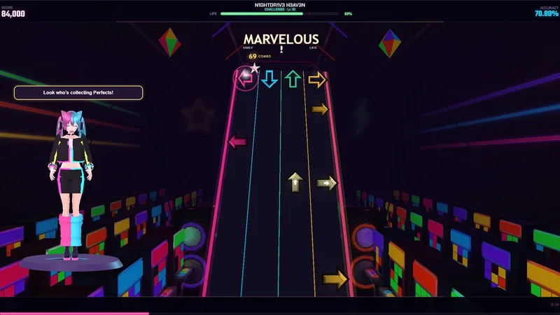
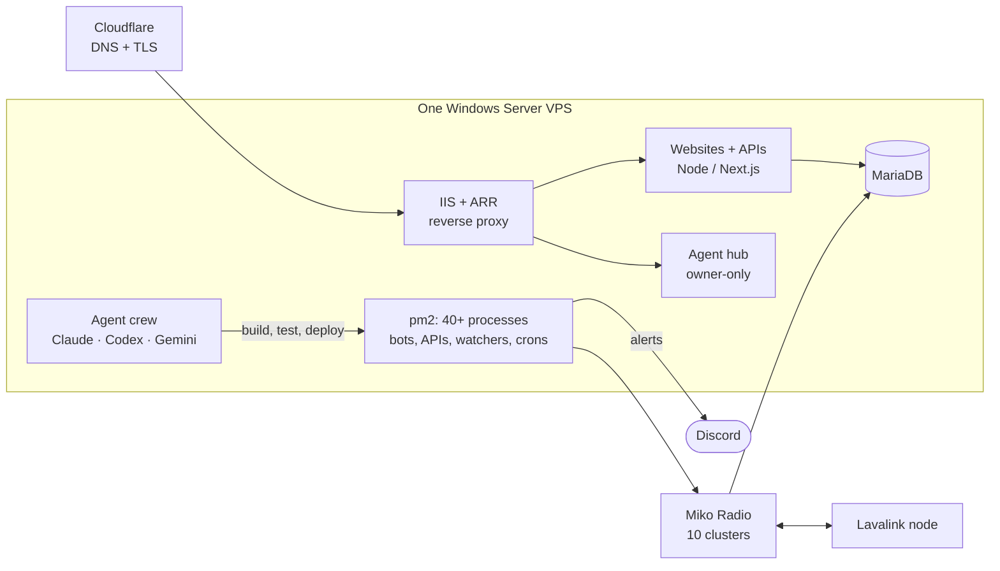

<div align="center">

<a href="https://korivash.com"></a>

<a href="https://korivash.com"></a>

[](https://korivash.com)
[](https://discord.gg/YxFRuEPSxZ)
[](https://www.youtube.com/@Korivash)
[](https://twitch.tv/korivash)
[](https://x.com/real_korivash)
[](https://open.spotify.com/artist/48u3iyT7qntFQvwEqBvjBQ)


</div>

## `$ status --live`

<sub>None of these are stock widgets. A zero-dependency Node script on my VPS pulls the production APIs (bot clusters, uptime monitors, CurseForge, GitHub, Spotify) every 10 minutes and renders animated SVGs. Writes are atomic, and when a source is down the card keeps its last good values instead of going blank.</sub>

<div align="center">

<a href="https://mikoradio.com/status"></a>
<a href="https://korivash.com/addons/"></a>
<a href="https://mikoradio.com/status"></a>
<a href="https://open.spotify.com/artist/48u3iyT7qntFQvwEqBvjBQ"></a>
<a href="https://github.com/Korivash?tab=repositories"></a>

</div>

## `$ ls ~/systems`

### 🎧 Miko Radio · distributed Discord music bot

**20,000+ servers · 10 shard clusters · 1M+ users.** Free for everyone, premium only lifts limits. [mikoradio.com](https://www.mikoradio.com/) · [status](https://mikoradio.com/status) · [add to Discord](https://discord.com/application-directory/1176036435523022969)

- **Own audio stack.** `@mikoradio/miko` is a TypeScript package I wrote to replace the off-the-shelf client: a Lavalink v4 REST + WebSocket client, guild players with queue/filters/voice-state handling, a module kit with dependency-ordered lifecycles, and a cluster planner that routes guilds by Discord snowflake.
- **Sharded runtime.** About 2,000 guilds per cluster. Every cluster reports a heartbeat (guilds, players, heap, memory level), and the health endpoint rolls them up into the public status page.
- **Data.** MariaDB with 1.4M+ rows: playlists, premium, per-server settings, Last.fm scrobbling. 3.8M+ tracks played.

<details>
<summary><b>Example: the search normalizer</b> (Lavalink load responses in, typed results out)</summary>

```js
/** Reject load errors; discard malformed entries without manufacturing unplayable tracks. */
export function normalizeSearch(raw, options) {
  if (!record(raw)) throw new Error("Invalid Lavalink load response.");
  const type = String(raw.loadType ?? "empty").toLowerCase();
  const data = raw.data;
  if (type === "error" || type === "load_failed") {
    const message = record(data) && typeof data.message === "string" ? data.message : "Lavalink track loading failed.";
    throw new Error(message.slice(0, 300));
  }
  if (type === "playlist" && record(data)) {
    return {
      type: MikoSearchResultType.PLAYLIST,
      playlistName: record(data.info) && typeof data.info.name === "string" ? data.info.name : undefined,
      tracks: (Array.isArray(data.tracks) ? data.tracks : []).filter(track).map(v => createMikoTrack(v, options.requester)),
    };
  }
  if (type === "track" && track(data))
    return { type: MikoSearchResultType.TRACK, tracks: [createMikoTrack(data, options.requester)] };
  return { type: MikoSearchResultType.SEARCH, tracks: type === "search" && Array.isArray(data) ? data.filter(track).map(v => createMikoTrack(v, options.requester)) : [] };
}
```

</details>

### ⚔️ World of Warcraft addons · Lua

**10 addons published on CurseForge, 10K+ downloads.** [Keystone Monitor](https://github.com/Korivash/KeystoneMonitor) is the flagship (Mythic+ keys for the whole party). The rest target **WoW Forever**: Dungeon Ledger, Legacy Tracker, AltoLite, Aggro Watch, Bindsafe, Ding Dash, Forever Party Board, Forever Haggle and Trade Bouncer (an RMT spam filter for trade chat). Guides at [korivash.com/addons](https://korivash.com/addons/).

- **Built against the real API.** A sparse clone of Blizzard's UI source for the Forever branch is the reference. A custom checker validates every `C_` namespace call in my addons against the Forever API docs before a build ships, next to a luacheck pass.
- **Release pipeline.** One script packages the zip (TOC per flavor, license, changelog), uploads it through the CurseForge API with the right game versions, then a Discord bot posts the release notes. A download monitor polls every 15 minutes and feeds the card above.

### 🎮 Miko Rhythm · four-lane rhythm game on Steam

<a href="https://store.steampowered.com/app/5450190/"></a>

**Electron + Three.js, 56 songs, 224 charts.** [Steam page](https://store.steampowered.com/app/5450190/)

- **Charts from audio.** Beat tracking turns each song into four difficulty charts. A timing gate rejects any chart whose notes drift more than 15 ms off the beat grid.
- **Feel.** Audio latency calibration and Auto-Sync, keyboard, controller or dance pad, Practice Mode, a Daily Challenge and a built-in chart editor.
- **Steamworks.** 40 achievements and Cloud saves. Every build gets headless render checks before it goes to the Steam beta branch.

<br clear="right" />

### 🛰️ Korivash Station · AI agent crew

A lead agent (Claude) plans, reviews and deploys. Codex builds and reviews, Gemini does research and art. Each agent has a `soul.md` (who it is), `memory.md` (what it learned), `task.md` (what it is doing) and `permissions.md` (what it may touch). I talk to the crew from my phone through a Discord relay. A private web hub draws the crew as a pixel-art town where every agent walks to the building for the job it is on. Public console: [agent-console-public](https://github.com/Korivash/agent-console-public).

### 🧰 More

| | Project | Notes |
|---|---|---|
| 🗺️ | **RouteTimecard** | Route and timecard app for lawn-care crews: route days, pay periods, invoices, QuickBooks export, offline route mode. Node + MariaDB, 130+ test files. Private beta at [routetimecard.com](https://routetimecard.com/) |
| 🎬 | **Render pipeline** | *Just Helping!* animated Shorts, rendered from code (HTML/Blender to ffmpeg), two a day, auto-archived to GitHub releases. [YouTube](https://www.youtube.com/@Korivash) |
| 📺 | **Twitch tools** | [ChatSkins](https://github.com/Korivash/chatskins): game-style chat overlays for OBS. **Wheel & Reel**: donation-triggered wheel and slots (StreamElements + bits + chat, Helix, MariaDB leaderboard) |
| 🧱 | **Game server tooling** | [FiveM error logs](https://github.com/Korivash/FiveM-Error-Logs), [MySQL autobackup](https://github.com/Korivash/mySQL-Autobackup-script), [AutoGitPull](https://github.com/Korivash/AutoGitPull), Palworld DDoS monitoring and Discord bridges |

## `$ cat infra.md`



<details>
<summary><b>Example: how the live cards stay up when a source fails</b></summary>

```js
/** Fetch with cache fallback. Returns { data, fromCache, error } */
async function source(name, cache, fn) {
  try {
    const data = await fn();
    cache[name] = { at: new Date().toISOString(), data };
    return { data, fromCache: false };
  } catch (err) {
    const cached = cache[name]?.data;
    return { data: cached ?? null, fromCache: !!cached, error: err.message };
  }
}

// atomic swap so the web server never serves a half-written file
await fs.writeFile(tmp, svg, 'utf8');
await fs.rename(tmp, path.join(OUT, name));
```

</details>

## `$ stack`

<div align="center">


</div>

| Area | Tools |
|---|---|
| **Bots** | TypeScript, Discord.js, Lavalink v4, sharding + clusters, MariaDB, Redis |
| **Web** | Node.js, Express, Next.js, React, Stripe, IIS + ARR, Cloudflare |
| **Games** | Three.js, Electron, Steamworks, beat tracking, Web Audio |
| **Addons** | Lua, Blizzard UI source, luacheck, CurseForge API |
| **Ops** | Windows Server, pm2, scheduled tasks, Playwright visual checks, ffmpeg |
| **AI crew** | Claude Code, Codex, Gemini CLI, shared memory files, permission scopes |

## `$ git log --oneline --reverse`

```text
2016  first line of code: tools for my own gaming communities
2020  FiveM servers: error logging, auto-updaters, backups, Discord webhooks
2022  all-in on TypeScript + Discord.js: sharded bots, dashboards, Twitch EventSub
2023  Miko Radio launches: Lavalink voice cluster, web dashboard, 24/7 radio
2024  Miko passes 10K servers on 10 clusters, public status page, premium tiers
2025  Twitch games and OBS overlays, AI in the build loop, Miko Rhythm begins
2026  own Lavalink client, 20K servers, 10 WoW addons, AI crew runs the VPS, Steam
```

## `$ gh stats`

<div align="center">


<picture>
  <source media="(prefers-color-scheme: dark)" srcset="https://raw.githubusercontent.com/Korivash/Korivash/output/github-snake-dark.svg" />
  
</picture>

</div>

<div align="center">

<sub>Everything above runs on one VPS I pay for. If something I built helps you: [Ko-fi](https://ko-fi.com/korivash) · [korivash.com/donate](https://korivash.com/donate)</sub>

</div>
